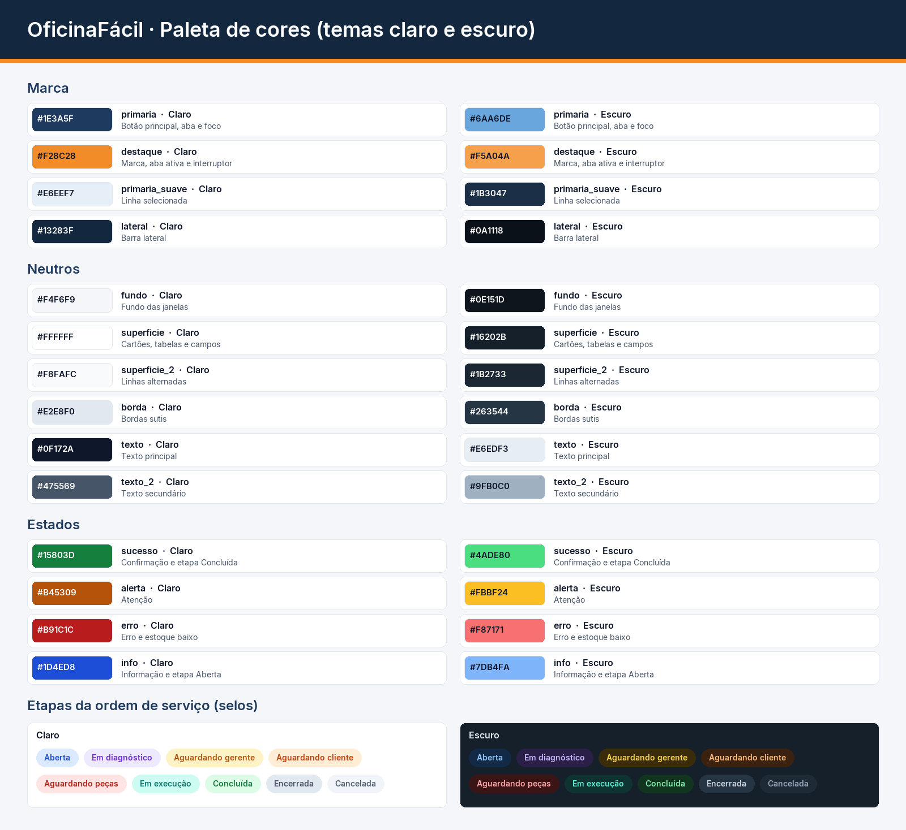

# Design system do OficinaFácil

Interface desktop em **PySide6 (Qt)**. Os tokens e a folha de estilos (QSS) ficam em
`oficinafacil/apresentacao/tema.py`, e os componentes reutilizáveis ficam em
`oficinafacil/apresentacao/componentes.py`. Nenhuma tela define cor, fonte ou espaçamento por conta
própria: tudo vem dos tokens.



## 1. Cores

Há dois temas, claro (`CLARO`) e escuro (`ESCURO`), com as mesmas chaves. A escolha fica salva
(`QSettings`) e pode ser trocada a qualquer momento pelo interruptor **Tema escuro**, na barra lateral
ou na tela de login.

| Token | Claro | Escuro | Uso |
|---|---|---|---|
| `fundo` | `#F4F6F9` | `#0E151D` | Fundo das janelas |
| `superficie` | `#FFFFFF` | `#16202B` | Cartões, tabelas, campos |
| `superficie_2` | `#F8FAFC` | `#1B2733` | Linhas alternadas e cabeçalho das tabelas |
| `realce` | `#EEF2F7` | `#223040` | Passar o mouse (hover) |
| `borda` / `borda_forte` | `#E2E8F0` / `#CBD5E1` | `#263544` / `#344759` | Bordas sutis / bordas de campos |
| `texto` | `#0F172A` | `#E6EDF3` | Texto principal |
| `texto_2` | `#475569` | `#9FB0C0` | Texto secundário, rótulos de tabela |
| `texto_desab` | `#94A3B8` | `#5B6B7A` | Desabilitado |
| `primaria` | `#1E3A5F` | `#6AA6DE` | Botão principal, aba e foco |
| `destaque` | `#F28C28` | `#F5A04A` | Marca, aba ativa, interruptor, foco do botão principal |
| `sucesso` · `alerta` · `erro` · `info` | `#15803D` · `#B45309` · `#B91C1C` · `#1D4ED8` | `#4ADE80` · `#FBBF24` · `#F87171` · `#7DB4FA` | Estados (com versões `_suave` para fundos) |
| `lateral` | `#13283F` | `#0A1118` | Barra lateral |

Cada etapa da OS tem um par de cores (texto e fundo) para o selo de status, nos dois temas
(`STATUS`), por exemplo *Aguardando gerente* = `#B45309` sobre `#FEF3C7` no tema claro.

**Contraste (WCAG AA):** todas as combinações de texto usadas chegam a pelo menos 4,5:1 (calculado
pela fórmula de luminância relativa da WCAG). Exemplos: `texto` sobre `superficie` = 17,9:1 (claro) e
13,9:1 (escuro); `texto_2` sobre `superficie` = 7,6:1 e 7,4:1; texto do botão principal = 11,5:1 e 7,1:1;
`erro` sobre `superficie` = 6,5:1 e 6,0:1; menu lateral = 9,9:1 e 8,5:1; o selo de etapa com menor
contraste tem 4,5:1 no tema claro e 5,7:1 no escuro.

## 2. Tipografia

Fonte **Inter** (embarcada em `recursos/fontes`), com números tabulares (`tnum`) em valores, quantidades
e tabelas, para que os algarismos fiquem alinhados.

| Token | Tamanho | Peso | Uso |
|---|---|---|---|
| `legenda` | 12 px | 400–600 | Ajuda, cabeçalho de tabela, selos |
| `corpo` | 14 px | 400–500 | Texto geral, campos, botões |
| `destaque` | 16 px | 600 | Título de cartão e de diálogo |
| `titulo_secao` | 20 px | 600 | Seções |
| `titulo` | 24 px | 600 | Título da página |
| `numero` | 32 px | 600 | Indicadores (KPI) |

Altura de linha de referência: 1,45.

## 3. Espaçamento, formas e profundidade

- **Grade de 4/8 px:** `xxs 4`, `xs 8`, `s 12`, `m 16`, `l 24`, `xl 32`, `xxl 48`. As páginas usam
  margem de 32 px e espaço de 24 px entre blocos; dentro dos cartões, 12 px.
- **Raios:** `p 6` (botões e campos), `m 10` (cartões e avisos), `g 16`.
- **Sombras (3 níveis):** `1` = desfoque 10, y 2, 6% (cartões); `2` = 20, 4, 10% (login e destaques);
  `3` = 36, 10, 18% (reservada para sobreposições). No tema escuro a opacidade é maior, para continuar
  visível.

## 4. Movimento

Transições de **150 ms** (rápida: interruptor, diálogos), **200 ms** (média: troca de página, toasts,
barra lateral) e **250 ms** (lenta: crescimento das barras dos gráficos), sempre com a curva *OutCubic*.
Se o Windows estiver com "Mostrar animações" desligado (ou com a variável `OFICINAFACIL_SEM_ANIMACAO`),
todas as durações viram zero (`duracao()` em `tema.py`).

## 5. Componentes

Todos os componentes têm os estados normal, hover, foco (borda de 2 px visível), pressionado e
desabilitado. Exemplos:

```python
from .componentes import Botao, Campo, entrada, selecao, notificar, confirmar, Tabela

salvar = Botao("Salvar", "primario", "save", "Salvar o cliente", self.salvar)  # primário com ícone e dica
Botao("Cancelar", "fantasma")                      # fantasma
Botao("Remover", "perigo", "trash-2")              # perigo (contorno); "perigo_cheio" no diálogo de confirmação
botao_icone("calendar", "Escolher no calendário")  # só ícone, com dica
salvar.carregando(True)                            # estado carregando (desabilita e mostra "Aguarde...")

nome = Campo("Nome", entrada("Nome completo"), "Como aparece no orçamento.", obrigatorio=True)
km = Campo("Quilometragem", entrada(), validar=inteiro_valido, unidade="km")   # número com unidade
nome.validar()            # mostra "Preencha este campo." abaixo do campo, com a borda vermelha
```

| Componente | Onde fica | Observações |
|---|---|---|
| `Botao`, `botao_icone` | componentes.py | Variantes primário, secundário, fantasma, perigo, só ícone; estado carregando |
| `Campo` | componentes.py | Rótulo, controle, ajuda e erro; valida enquanto digita depois do primeiro erro |
| `entrada`, `selecao`, `area_texto`, `quantidade` | componentes.py | Texto, seleção (com id), texto longo, número com setas |
| `Busca` | componentes.py | Lupa, pesquisa enquanto digita (180 ms), Esc limpa |
| `CampoData`, `SeletorPeriodo` | componentes.py | Data digitada ou no calendário, vazia permitida; atalhos de período |
| `Interruptor` | componentes.py | Switch animado (tema claro/escuro) |
| `Cartao`, `Selo`, `selo_status`, `Avatar` | componentes.py | Superfícies, etiquetas de status e iniciais do usuário |
| `Tabela` | componentes.py | Cabeçalho fixo, ordenação por coluna, zebra, colunas pelo conteúdo, selo de status, paginação (50 por página), ações no botão direito, duplo clique/Enter, estados **vazio**, **carregando** (esqueleto) e **erro** com "Tentar de novo" |
| `EstadoVazio`, `Esqueleto` | componentes.py | Ilustração simples (ícone em círculo), texto e ação sugerida; barras de carregamento |
| `notificar` (toast) | componentes.py | Sucesso, erro, alerta e info, no canto inferior direito, somem sozinhos |
| `Dialogo`, `confirmar`, `informar`, `pedir` | componentes.py | Modais com título, subtítulo, foco no primeiro campo, Esc cancela; confirmação de ações destrutivas em vermelho |
| `Kpi`, `GraficoBarras`, `barra_progresso` | componentes.py | Indicadores do painel, gráficos com as cores do tema e progresso do pagamento |
| `BarraLateral`, `Cabecalho` | tela_principal.py | Menu recolhível com ícones (animação de largura), título da página, ações e usuário |

## 6. Telas

| Tela | Estrutura |
|---|---|
| Login | Painel da marca à esquerda; cartão com o endereço do servidor central, login e senha, validação e aviso de erro (inclusive sem conexão) na própria tela |
| Painel | Indicadores por etapa (gerente e atendente), alerta de estoque mínimo e tabela de pendências |
| Ordens de serviço | Filtros em cartão (status, cliente, placa, período), tabela com selos, ação Nova OS (Ctrl+N) |
| Clientes e veículos | Dois cartões lado a lado, com busca, tabela e formulário em duas colunas |
| Peças e serviços | Busca única com o filtro "só peças em falta" e duas tabelas; peças sem estoque em vermelho; Solicitar compra no cabeçalho, no duplo clique e no menu da peça |
| Compras | Indicadores por situação (clicar filtra), filtros em cartão (situação, destino, fornecedor, peça, nº da OS, período, só as minhas), tabela com selos de situação, detalhes da linha selecionada e botões habilitados conforme a situação e o perfil; diálogo Nova solicitação com peça, quantidade sugerida, destino (OS ou estoque) e observação |
| Catálogo | Abas Serviços, Peças e Fornecedores |
| Usuários | Tabela e formulário, senha com texto de ajuda |
| Relatórios | Período, indicadores (OS, faturamento, tempo médio) e gráficos de barras; exportação em PDF |
| Janela da OS | Trilha, título com selo, cartão do atendimento, cartão de valores com progresso do pagamento, barra de ações conforme perfil e etapa, abas com as tabelas |

## 7. Acessibilidade e textos

- Navegação completa por teclado: Tab segue a ordem visual; Enter abre a linha selecionada; Esc fecha
  diálogos e a janela da OS; Ctrl+1 a Ctrl+9 trocam de página; Ctrl+N abre uma nova OS.
- Foco sempre visível (borda de 2 px na cor primária, ou laranja no botão principal e no menu).
- Todos os campos têm rótulo associado (`setBuddy`) e nome acessível; botões só com ícone têm dica.
- Textos em português do Brasil, com o mesmo verbo para a mesma ação: **Salvar** (cadastros),
  **Registrar** (eventos da OS), **Abrir** (OS), **Cancelar** (fechar sem salvar).
- Janela redimensionável, com tamanho mínimo de 1000 × 640 (janela da OS: 920 × 640) e rolagem quando
  o espaço não basta; ícones e logotipo vetoriais, nítidos em telas de alta resolução.

## 8. Capturas

`docs/telas/` (tema claro) e `docs/telas/escuro/` (tema escuro), geradas sem abrir janelas,
com uma base de demonstração.
