# OficinaFácil: Itens 8 a 10 do TCD

Gerado a partir do mesmo conteúdo do documento de entrega (`definitiva/TCD_ESOF3_OficinaFacil_Itens_1_a_10.docx`). As referências marcadas com * apontam para figuras e quadros da Primeira Parte, no documento de entrega.

---

## 8. Apresente os materiais para o desenvolvimento do TCD

Esta parte apresenta o sistema OficinaFácil implementado a partir da modelagem dos itens 1 a 7. Para manter o sistema simples de instalar e de usar numa oficina pequena, ele foi construído como aplicação desktop, com a linguagem Python e somente com a sua biblioteca padrão (PYTHON SOFTWARE FOUNDATION, 2025). O código implementa os 35 requisitos funcionais (RF01 a RF35) e as dez regras de negócio (RN01 a RN10), com as 14 tabelas do modelo de dados (Quadro 29*).

### a. Linguagens de programação.


**Quadro 1 - Linguagens de programação.**

| Linguagem | Uso no sistema |
|---|---|
| Python 3 (desenvolvido e testado na versão 3.14.4; funciona a partir da 3.10) | Todo o sistema: interface gráfica, regras de negócio, persistência e testes automatizados. |
| SQL (dialeto do SQLite) | Criação das 14 tabelas, com chaves primárias e estrangeiras, e consultas parametrizadas. |

Nenhum pacote externo é necessário. O Quadro 2 mostra os módulos da biblioteca padrão usados e a função de cada um.


**Quadro 2 - Módulos da biblioteca padrão do Python usados no sistema.**

| Módulo | Função no sistema |
|---|---|
| tkinter / ttk | Interface gráfica: janelas, abas, tabelas e formulários (RNF01, RNF13). |
| sqlite3 | Banco de dados relacional embutido no arquivo oficinafacil.db, com transações e backup (RNF05, RNF06). |
| hashlib e hmac | Hash das senhas com PBKDF2-SHA256 e sal aleatório (RNF03). |
| datetime | Data e hora do histórico de status, dos orçamentos e dos pagamentos (RNF09). |
| functools | Decorador que executa cada operação como transação e a desfaz em caso de erro (RNF06). |
| unittest | Testes automatizados unitários, de integração e não funcionais (item 10). |

O código é orientado a objetos e segue as camadas do diagrama de componentes (Figura 20*), com um pacote para cada pacote do diagrama de pacotes (Figura 21*). As telas chamam os controladores; cada controlador cria, no construtor, os DAOs e os serviços de que precisa e aplica as regras de negócio; os DAOs fazem o CRUD com consultas parametrizadas e devolvem objetos do modelo. O Quadro 3 relaciona cada camada aos arquivos do sistema.


**Quadro 3 - Camadas do diagrama de componentes e pacotes do código.**

| Camada | Pacote | Conteúdo |
|---|---|---|
| Apresentação | oficinafacil/apresentacao | App, TelaLogin, TelaPrincipal (com as abas), JanelaOS e componentes comuns (tabela, formulário e diálogos), em tkinter. |
| Controle | oficinafacil/controle | AuthController, CadastroController, OSController, OrcamentoController, PecasComprasController, PagamentoController e RelatorioController, com a transação de cada operação (RNF06) e a mudança de status (RF12). |
| Serviços | oficinafacil/servico | ServicoSeguranca (hash e perfis), ServicoOrcamento (totais e versões), ServicoEstoque (disponibilidade e baixa), ServicoNotificacao (pendências e mensagem ao cliente) e ServicoRelatorio (relatório e PDF). |
| Persistência | oficinafacil/persistencia | Conexao (14 tabelas, dados iniciais e backup) e os DAOs UsuarioDAO, ClienteVeiculoDAO, OrdemServicoDAO, OrcamentoDAO, EstoqueDAO e PagamentoDAO. |
| Modelo | oficinafacil/modelo | Classes de domínio em três módulos: cadastro, catalogo e atendimento, com as enumerações StatusOS, Perfil, SituacaoOrcamento e SituacaoCompra. |
| Inicialização | main.py | Abre o banco, faz o backup do dia e mostra a tela de login. |
| Testes | tests/ | Scripts de teste automatizado (item 10). |

### b. Ambientes de desenvolvimento.


**Quadro 4 - Ambientes e ferramentas de desenvolvimento.**

| Ferramenta | Uso |
|---|---|
| Windows 11 Pro | Sistema operacional de desenvolvimento e de testes. |
| Python 3.14.4 e IDLE | Interpretador e ambiente básico de edição e execução. |
| Visual Studio Code | Edição do código e execução dos testes. |
| DB Browser for SQLite (opcional) | Inspeção do arquivo oficinafacil.db durante os testes. |
| Git e GitHub | Versionamento e entrega do código (item 9b). |
| Astah UML 12 e HEFLO | Modelagem UML e BPMN da Primeira Parte. |

### c. Manual de Instalação do sistema desenvolvido.

**Requisitos:** computador com Windows 10 ou 11, Linux ou macOS e Python 3.10 ou mais novo. Não é preciso servidor, banco de dados separado nem internet (RNF07, RNF11).

1. **Instalar o Python.** Baixar o instalador em https://www.python.org/downloads/ e executá-lo. No Windows, marcar a opção “Add python.exe to PATH” antes de clicar em “Install Now”. No Linux, se o tkinter não vier junto, instalar o pacote python3-tk.
2. **Conferir a instalação.** Abrir o Prompt de Comando e digitar python --version. Deve aparecer “Python 3.x.x”.
3. **Obter o sistema.** Baixar o repositório do GitHub (botão “Code”, opção “Download ZIP”) e descompactar, ou usar git clone com o endereço do repositório.
4. **Executar.** Entrar na pasta sistema e digitar python main.py. No Windows também é possível dar dois cliques no arquivo main.py.
5. **Primeiro acesso.** Na primeira execução o sistema cria o banco oficinafacil.db, com um usuário de cada perfil (Quadro 5) e alguns itens de catálogo. O gerente deve trocar as senhas na aba Usuários logo no primeiro acesso.
6. **Backup.** A cada dia em que o sistema é aberto, uma cópia do banco é gravada na pasta backups, com o nome oficinafacil_AAAA-MM-DD.db; as 30 mais recentes são mantidas (RNF05). Para restaurar, fechar o sistema e copiar o backup desejado por cima de oficinafacil.db. Recomenda-se copiar a pasta backups para um HD externo ou para a nuvem (Figura 24*).
7. **Testes (opcional).** Na pasta sistema, digitar python -m unittest discover -s tests -v.

**Quadro 5 - Usuários criados na primeira execução.**

| Login | Senha inicial | Perfil |
|---|---|---|
| gerente | 123 | Gerente |
| atendente | 123 | Atendente |
| mecanico | 123 | Mecânico |

### d. Manual de Usuário (para um usuário leigo, os passos básicos de como se deve usar o sistema de informação desenvolvido).

**Entrar e sair.** Abra o sistema, digite o login e a senha e clique em Entrar (Figura 1). Cada funcionário vê apenas as abas do seu perfil (Quadro 6). Para trocar de usuário, clique em Sair, no canto superior direito.


**Quadro 6 - Abas disponíveis para cada perfil.**

| Aba | Atendente | Mecânico | Gerente |
|---|---|---|---|
| Painel | Sim | Sim | Sim |
| Ordens de serviço | Sim | Sim | Sim |
| Clientes e veículos | Sim | Não | Sim |
| Compras, Catálogo, Usuários e Relatórios | Não | Não | Sim |

**Painel.** Mostra quantas OS há em cada etapa e a lista “Minhas pendências”, que é o aviso do sistema para cada perfil: o mecânico vê as OS novas e as que estão sob sua responsabilidade; o gerente vê os orçamentos a aprovar e as OS que esperam peças; o atendente vê os orçamentos aprovados e os serviços concluídos. Dê dois cliques numa linha para abrir a OS.

**Janela da OS.** Todas as ações sobre uma OS são feitas pelos botões no alto da janela, e só aparecem os botões que podem ser usados naquele momento, conforme o perfil e a etapa da OS. O passo a passo de um atendimento completo é o seguinte:

1. **Atendente ou gerente: cadastrar o cliente e o veículo** (na primeira visita). Na aba Clientes e veículos, clique em Novo, preencha nome e telefone (o CPF é opcional) e clique em Salvar. Com o cliente selecionado, preencha placa, marca e modelo do lado direito e clique em Salvar.
2. **Atendente ou gerente: abrir a OS.** Na aba Ordens de serviço, clique em Nova OS, escolha o cliente e o veículo, confira a quilometragem, escreva o problema relatado e clique em OK. O mecânico é avisado no painel.
3. **Atendente ou mecânico: classificar.** Na OS, use Classificar atendimento. Serviço simples (por exemplo, troca de óleo) vai direto para execução, sem orçamento; avaliação completa segue para o diagnóstico.
4. **Mecânico: registrar o diagnóstico.** Use Registrar diagnóstico, descreva o problema, escolha os serviços e as peças necessárias com a quantidade, clicando em Adicionar, e clique em OK. O orçamento é calculado automaticamente e enviado ao gerente.
5. **Gerente: aprovar o orçamento.** Confira os itens. Para mudar um preço, selecione o item e use Alterar valor de item, que cria uma nova versão do orçamento. Depois clique em Aprovar orçamento.
6. **Atendente: apresentar ao cliente.** Exportar orçamento (PDF) gera o arquivo para imprimir ou enviar. Em seguida, use Registrar decisão do cliente. Se o cliente aprovou e há peças, o serviço é liberado ao mecânico; se falta peça, o sistema cria a solicitação de compra. Se o cliente rejeitou, informe o motivo e a OS é cancelada.
7. **Gerente: comprar peças** (só quando falta peça). Na aba Compras, selecione a solicitação, clique em Registrar compra e escolha o fornecedor. Quando as peças chegarem, clique em Registrar recebimento: o estoque é atualizado e a OS volta para execução.
8. **Mecânico: executar e concluir.** Terminado o trabalho, use Registrar execução para confirmar os serviços e as peças usados; nesse momento o estoque é baixado. Em serviço simples, informe ali os serviços e as peças; com orçamento aprovado, não é possível acrescentar itens, porque eles exigiriam nova aprovação. Para as peças trocadas, selecione a peça e use Destinação de resíduo. Por fim, clique em Concluir serviço: o atendente é avisado no painel.
9. **Atendente: avisar, receber e entregar.** Avisar cliente mostra um texto pronto, já copiado para colar no WhatsApp; depois de enviar, confirme o aviso, que fica registrado na OS. Quando o cliente pagar, use Registrar pagamento (valor e forma). Por fim, clique em Entregar veículo e encerrar. O sistema não permite a entrega sem o pagamento do valor total.
**Outras funções.** Na aba Ordens de serviço é possível filtrar as OS por status, cliente, placa e período. Na aba Clientes e veículos, os botões Histórico do cliente e Histórico do veículo mostram as OS anteriores. Na janela da OS, a aba Histórico de status mostra quem mudou cada etapa e quando. O gerente mantém o catálogo, os usuários e consulta os relatórios; as peças abaixo do estoque mínimo aparecem em vermelho no seu painel. O Quadro 7 explica as mensagens mais comuns.


**Quadro 7 - Mensagens mais comuns do sistema.**

| Mensagem | O que fazer |
|---|---|
| Login ou senha inválidos, ou usuário inativo. | Conferir os dados ou pedir ao gerente para reativar o usuário. |
| A placa ... já está cadastrada para o cliente ... (RN08). | O veículo já existe; procurá-lo pelo cliente indicado. |
| Registre a execução (serviços e peças usados) antes de concluir. | Usar Registrar execução e depois Concluir serviço. |
| Entrega bloqueada: pagamento não registrado (RN07). | Registrar o pagamento do valor total antes da entrega. |
| A OS ... está ...; a operação exige ... | A OS está em outra etapa; conferir o status no alto da janela. |
| Operação permitida apenas para: ... | A função pertence a outro perfil. |

---

## 9. Apresente os resultados do desenvolvimento do sistema por meio do cronograma de execução (marcos de entrega).

O desenvolvimento foi iterativo e incremental, como previsto nas premissas (item 1c): cada marco entregou um grupo de requisitos funcionando e testado. O Quadro 8 apresenta o cronograma de execução e o Quadro 9 mostra em qual método de qual controlador cada requisito foi implementado.


**Quadro 8 - Cronograma de execução e marcos de entrega.**

| Marco | Entrega | Requisitos | Período | Situação |
|---|---|---|---|---|
| M1 | Banco de dados: 14 tabelas e dados iniciais | Quadro 29*, RNF06 | Semana 1 | Concluído |
| M2 | Acesso e cadastros: login, usuários, clientes, veículos, catálogos e fornecedores | RF01 a RF07 | Semana 1 | Concluído |
| M3 | Ordem de serviço: abertura, classificação, diagnóstico, status e histórico | RF08 a RF13 | Semana 2 | Concluído |
| M4 | Orçamento: geração, versões, aprovação, PDF e decisão do cliente | RF14 a RF20 | Semana 2 | Concluído |
| M5 | Peças e compras, execução e conclusão | RF21 a RF28 | Semana 3 | Concluído |
| M6 | Aviso ao cliente, pagamento, entrega, histórico, relatórios e painel | RF29 a RF35 | Semana 3 | Concluído |
| M7 | Testes automatizados, backup, manuais e publicação no GitHub | RNF02 a RNF10; item 10 | Semana 4 | Concluído |


**Quadro 9 - Rastreabilidade entre requisitos funcionais e métodos dos controladores.**

| Requisitos | Controlador | Métodos |
|---|---|---|
| RF01, RF02 | AuthController | autenticar, salvar_usuario, alternar_ativo |
| RF03 a RF07 | CadastroController | salvar_cliente, salvar_veiculo, salvar_servico, salvar_peca, salvar_fornecedor e as consultas get_... |
| RF08 a RF13 | OSController | abrir_os, pendencias (RF10), classificar, registrar_diagnostico, get_historico_status (RF12, com a função mudar_status), get_lista |
| RF14 a RF20 | OrcamentoController | gerar_orcamento, alterar_valor_item, aprovar, exportar_pdf, registrar_decisao_cliente (com OSController.autorizar_execucao no RF19) |
| RF21 a RF25 | PecasComprasController | verificar_pecas, solicitar_faltantes, solicitar_compra, registrar_compra, registrar_recebimento, cancelar_solicitacao, registrar_destinacao (a baixa do RF24 é feita por ServicoEstoque) |
| RF26 a RF29 | OSController | registrar_execucao, concluir_servico, pendencias (RF28), gerar_mensagem, registrar_aviso_cliente |
| RF30 a RF32 | PagamentoController | registrar_pagamento, entregar_veiculo |
| RF33 a RF35 | RelatorioController | historico_manutencao, gerar, exportar_pdf, painel |

### a. Interfaces com o usuário.

As figuras a seguir mostram as principais telas do sistema, capturadas com uma base de demonstração que tem quatro OS em etapas diferentes. A interface usa rótulos em todos os campos, fonte ampliada e navegação por teclado (RNF01, RNF13).

**Figura 1 - Tela de login (RF01).**

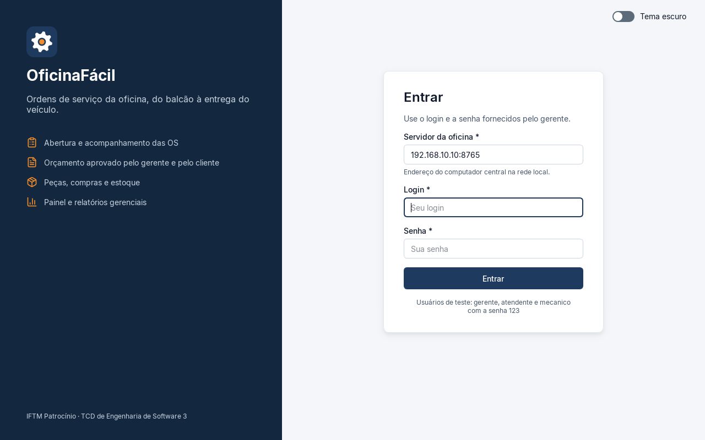

**Figura 2 - Painel do gerente: OS por etapa, pendências e alerta de estoque mínimo (RF15, RF35).**

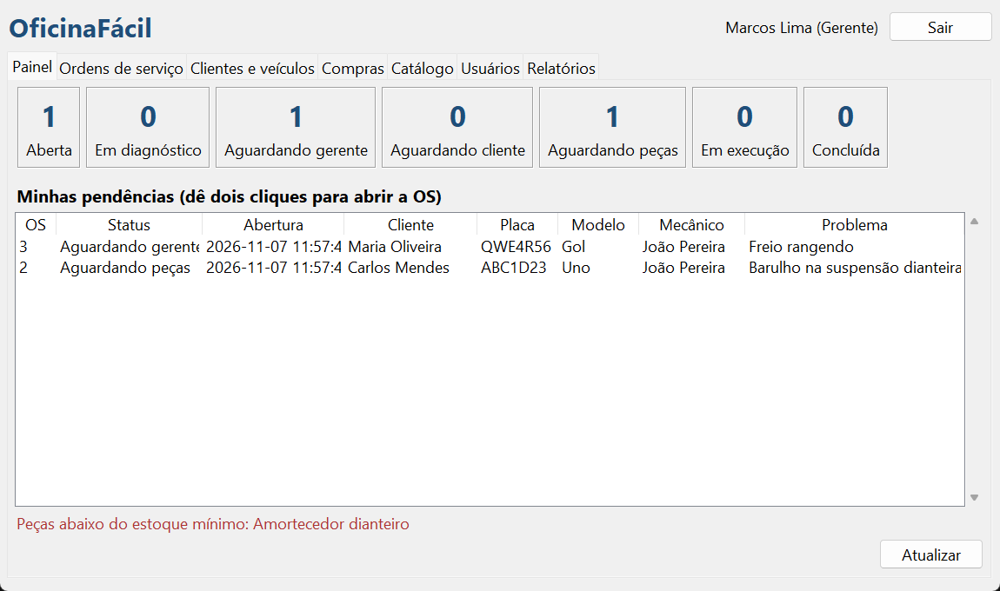

**Figura 3 - Painel do mecânico: OS novas e sob sua responsabilidade (RF10).**

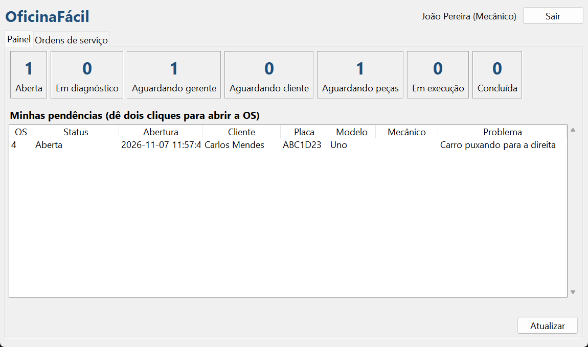

**Figura 4 - Consulta de ordens de serviço com filtros (RF13).**

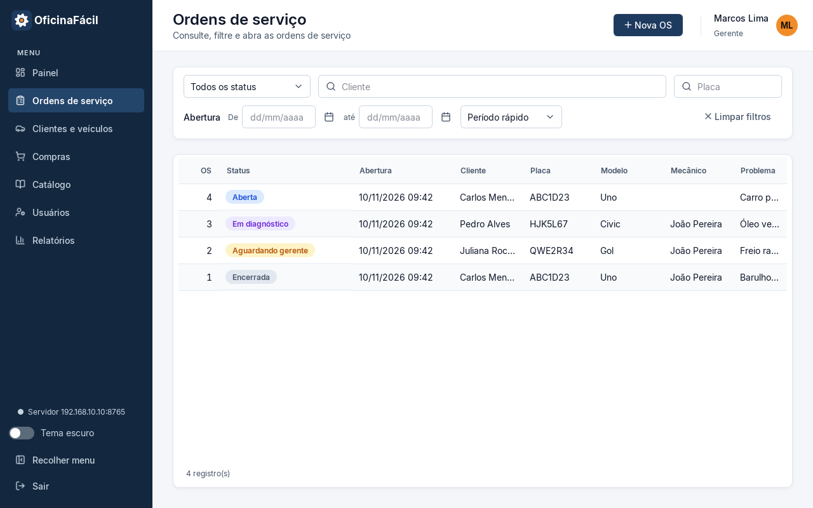

**Figura 5 - Janela da OS aberta, com o botão de classificação do atendimento (RF09).**

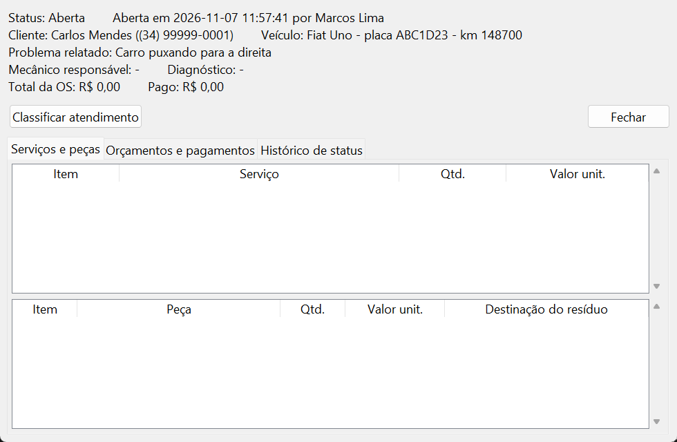

**Figura 6 - Janela da OS aguardando o gerente: alterar valor e aprovar o orçamento (RF16).**

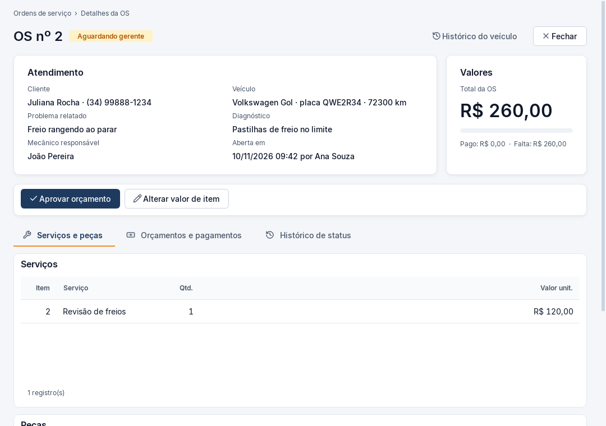

**Figura 7 - Janela de uma OS encerrada, vista pelo atendente (RF30 a RF32).**

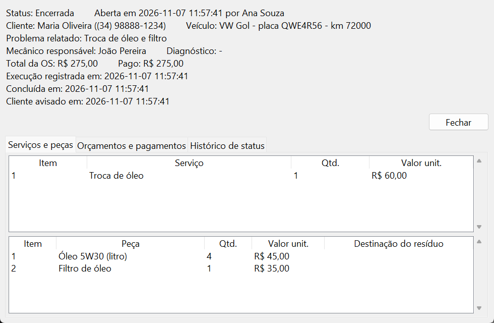

**Figura 8 - Cadastro de clientes e veículos e acesso ao histórico (RF03, RF04, RF33).**

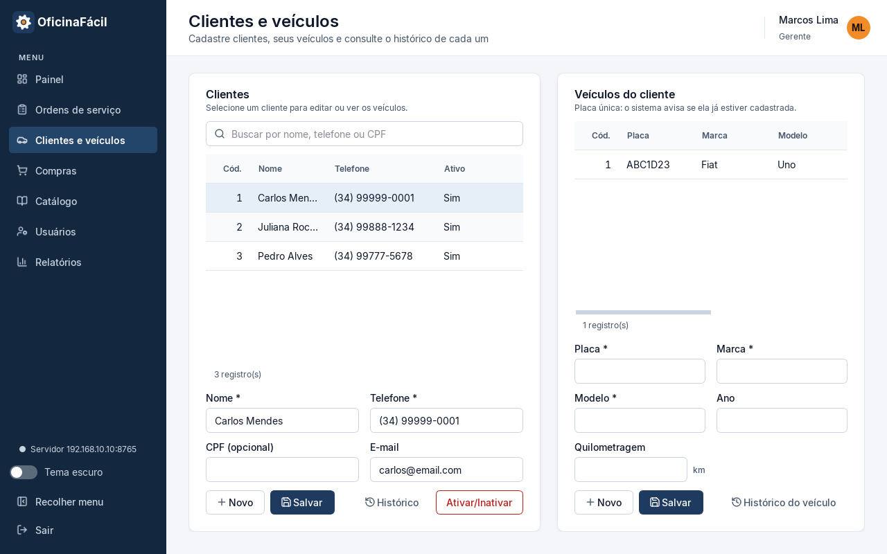

**Figura 9 - Solicitações de compra de peças (RF22, RF23).**

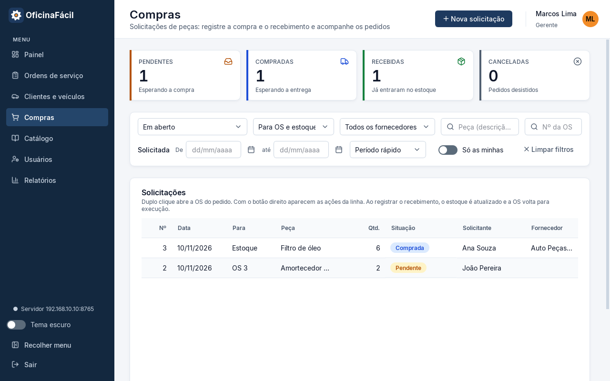

**Figura 10 - Catálogo de serviços, peças e fornecedores (RF05 a RF07).**

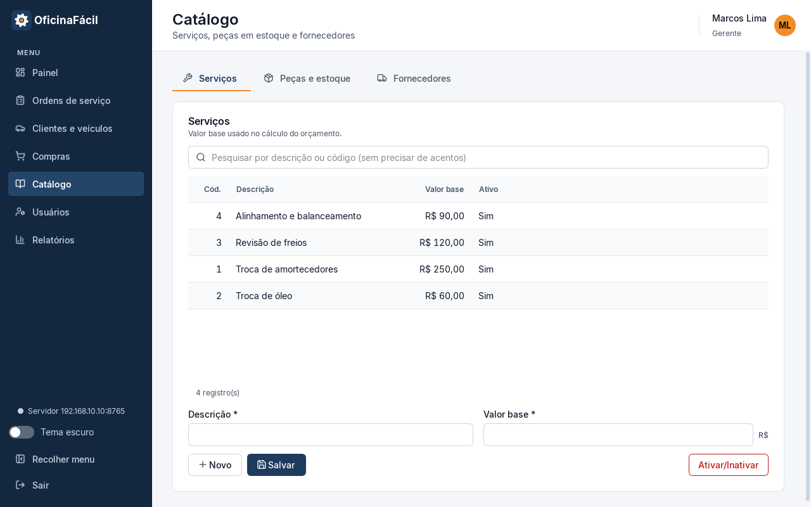

**Figura 11 - Cadastro de usuários e perfis (RF02).**

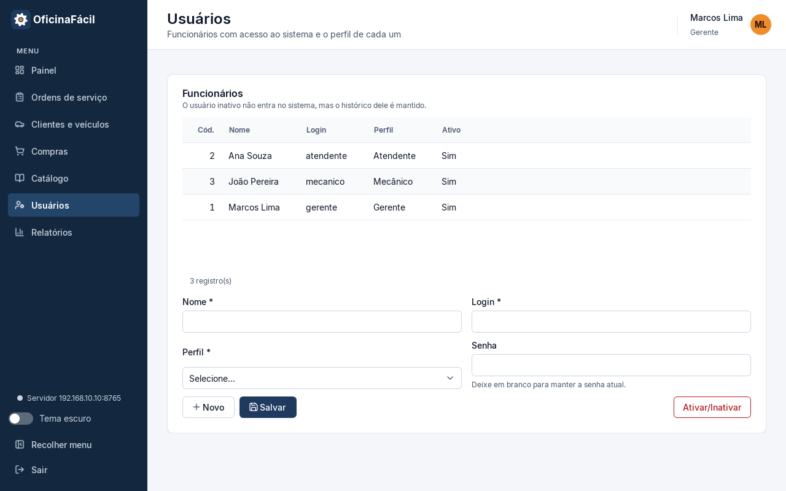

**Figura 12 - Relatório gerencial (RF34).**

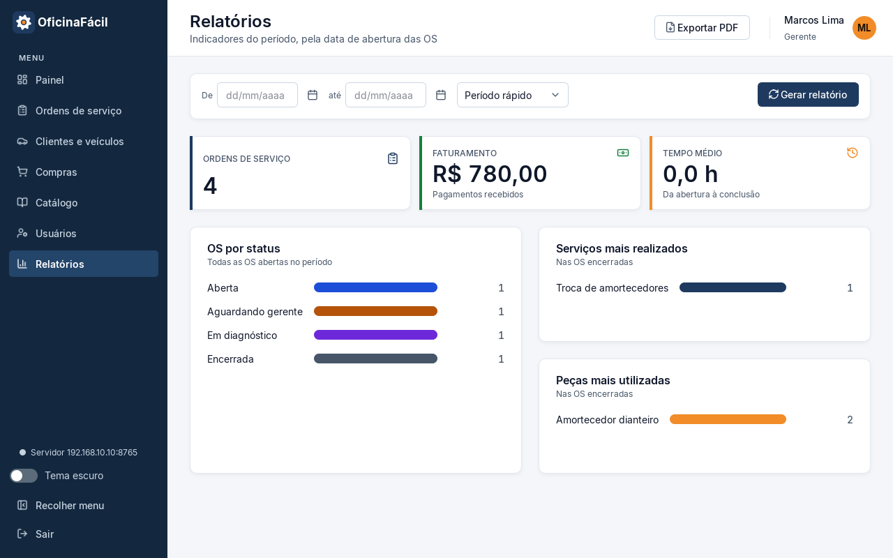

### b. Entregas no Github dos códigos.

O código é versionado com Git e publicado no GitHub (RNF08), no repositório público https://github.com/Gustavo-A-dos-Santos/oficinafacil, na ramificação (branch) main. O Quadro 10 mostra a organização do repositório e o Quadro 11, as entregas.


**Quadro 10 - Organização do repositório.**

| Caminho | Conteúdo |
|---|---|
| README.md | Descrição do sistema, como executar e como testar. |
| main.py | Ponto de entrada do sistema. |
| oficinafacil/ | Código-fonte, nos pacotes apresentacao, controle, servico, persistencia e modelo. |
| tests/ | Testes automatizados: apoio.py (pré-condições comuns), test_unitarios.py, test_integracao.py e test_nao_funcionais.py. |
| docs/ | Documentação dos itens 8 a 10 e capturas das telas. |
| .gitignore | Exclui do repositório o banco local e os backups, que contêm dados de clientes (RNF04). |


**Quadro 11 - Entregas no GitHub.**

| Entrega | Conteúdo | Itens |
|---|---|---|
| Commit 829394b (07/11/2026) | Sistema completo: código-fonte, testes automatizados, README, documentação e capturas de tela. | 8, 9 e 10 |
| Commits seguintes | Correções e ajustes apontados pelos testes e pela avaliação, um commit por alteração. | 10 |

Para enviar uma alteração, na pasta sistema: git add .; git commit -m "descrição da alteração"; e git push. Para obter o código: git clone https://github.com/Gustavo-A-dos-Santos/oficinafacil.git.

---

## 10. Testes do sistema quanto aos objetivos e ao ciclo de vida do sistema

Os testes verificam se o sistema cumpre os objetivos definidos na Primeira Parte, isto é, os requisitos funcionais, as regras de negócio e os requisitos não funcionais, e acompanham o ciclo de vida do sistema, da construção à manutenção. Seguem a divisão de Sommerville (2011) entre testes de desenvolvimento (unitários e de integração), testes de sistema e testes de aceitação.

### a. Seminário sobre os testes de software (apresentação de seminário do sorteio sobre testes e com conteúdo gamificado).

[Preencher com o tema de teste sorteado para o seminário, o resumo do conteúdo apresentado e a dinâmica gamificada usada na apresentação.]

### b. Escolha do tipo de teste com base nos seminários (Justificativa da escolha dos tipos de testes a serem realizados (ex: testes unitários para verificar funções específicas, testes de integração para validar a interação entre módulos).

Foram escolhidos quatro tipos de teste, apresentados no Quadro 12. Os três primeiros são automatizados e executados a cada alteração do código; o teste de sistema é manual, feito nas telas como o funcionário faria.


**Quadro 12 - Tipos de teste escolhidos.**

| Tipo | Objetivo no OficinaFácil | Forma |
|---|---|---|
| Unitário | Verificar cada regra isolada: hash de senha, placa única, cálculo do orçamento, versões, transições de status inválidas. | Automatizado (test_unitarios.py) |
| Integração | Verificar controladores, serviços, DAOs e banco juntos, percorrendo o ciclo completo da OS do diagrama de estados (Figura 13*). | Automatizado (test_integracao.py) |
| Não funcional | Verificar segurança (SQL Injection), transações, rastreabilidade, backup e desempenho com 10.000 OS. | Automatizado (test_nao_funcionais.py) |
| Sistema e aceitação (caixa-preta) | Usar as telas como o funcionário usaria, seguindo o manual de usuário. | Manual (roteiros CT-S) |

#### Requisitos do projeto

As regras de negócio RN01 a RN10 definem o fluxo da OS. Uma falha nelas, como entregar o veículo sem pagamento ou executar o serviço sem aprovação, quebra o processo TO-BE. Por isso cada regra é coberta por testes unitários e o fluxo inteiro, por testes de integração. Os requisitos não funcionais mensuráveis (RNF02, RNF03, RNF05, RNF06, RNF09 e RNF10) têm testes próprios.

#### Risco associado e impacto no usuário final


**Quadro 13 - Riscos, impacto no usuário final e testes que os mitigam.**

| Risco | Impacto | Casos de teste |
|---|---|---|
| Veículo entregue sem pagamento | Prejuízo financeiro direto para a oficina. | CT-U12, CT-I01, CT-I02, CT-S03 |
| Cálculo errado do orçamento | Cobrança errada e perda da confiança do cliente. | CT-U10, CT-U11 |
| Serviço executado sem aprovação | Conflito com o cliente (RN03). | CT-U12, CT-I03 |
| Estoque inconsistente | Falta de peça e atraso no serviço. | CT-U14, CT-I01, CT-I02 |
| Vazamento ou perda de dados | Descumprimento da LGPD e perda do histórico. | CT-U01, CT-N02, CT-N04 |
| Lentidão com muitas OS | Atendimento demorado no balcão. | CT-N05 |

#### Recursos disponíveis (tempo e equipe)

O projeto tem um desenvolvedor e poucas semanas para os testes. Por isso foi escolhido o unittest, que já vem com o Python e executa toda a bateria automática em cerca de 10 segundos, e a interface é testada manualmente com roteiros curtos.

### c. Materiais usados no teste (ferramentas) - Função de cada ferramenta e como ela será utilizada durante os testes.


**Quadro 14 - Ferramentas de teste.**

| Categoria | Ferramenta | Função e forma de uso |
|---|---|---|
| Teste automatizado | unittest (biblioteca padrão do Python, equivalente ao JUnit) | Executa os testes unitários, de integração e não funcionais. Cada teste usa um banco novo em memória, então os testes são independentes e não alteram o banco real. |
| Teste de interface | Roteiros manuais (CT-S) | Executados nas telas do sistema, seguindo o manual de usuário. |
| Gestão de testes | GitHub Issues e GitHub Projects (no lugar de TestRail ou JIRA) | Cada defeito vira uma issue com o código do caso de teste; o quadro do Project acompanha as colunas A fazer, Em correção, Retestar e Fechado. |
| Desempenho | time.perf_counter, dentro do unittest (no lugar do JMeter) | O caso CT-N05 insere 10.000 OS e mede o tempo das consultas principais. Como o sistema é desktop, sem servidor HTTP, o JMeter não se aplica. |
| Versionamento | Git e GitHub | Os scripts ficam na pasta tests, junto com o código, e mudam no mesmo commit da funcionalidade testada. |

### d. Script detalhado e escrita do tipo de teste que será realizado (Como os scripts serão documentados e versionados).

Cada teste automatizado é um método chamado test_CT_<tipo><número>_<descrição>, com um comentário de documentação (docstring) que explica o objetivo e o requisito verificado. O código do caso (CT-U para unitários, CT-I para integração, CT-N para não funcionais e CT-S para os de sistema) liga o script à listagem do item 10e. Os scripts são versionados no Git junto com o código.

#### Estrutura dos scripts (cabeçalho, pré-condições, passos, resultados esperados)


**Quadro 15 - Estrutura dos scripts de teste.**

| Parte | Onde fica no script automatizado |
|---|---|
| Cabeçalho | Nome do método (código do caso de teste) e docstring com objetivo e requisito. |
| Pré-condições | Método setUp() da classe BaseTeste (tests/apoio.py): banco novo em memória, com os três usuários e o catálogo inicial, e os sete controladores. |
| Passos | Chamadas aos métodos dos controladores, na ordem do caso de uso. |
| Resultados esperados | Verificações assertEqual, assertIn, assertRaises etc. |

#### Exemplos de scripts para cada tipo de teste escolhido


**Quadro 16 - Caso de teste unitário CT-U11.**

| Campo | Conteúdo |
|---|---|
| Caso | CT-U11: alteração de valor gera nova versão do orçamento |
| Requisitos | RF16, RN10 |
| Pré-condição | OS com diagnóstico registrado: 1 serviço de R$ 250,00 e 2 peças de R$ 265,00. |
| Passos | O gerente altera o valor do serviço para R$ 200,00. |
| Resultado esperado | Versão 1 com situação ALTERADO; versão 2 PENDENTE_APROVACAO com total de R$ 730,00; a OS continua Aguardando gerente. |

Script correspondente (arquivo tests/test_unitarios.py):

```python
def test_CT_U11_alteracao_gera_nova_versao(self):
    """RF16, RN10."""
    os_id = self.os_aguardando_gerente()
    item = self.c.os.get_itens(os_id)[0][0]
    self.c.orcamento.alterar_valor_item(self.gerente, os_id, "servico", item.id, 200)
    versoes = self.c.orcamento.get_versoes(os_id)
    self.assertEqual([v.situacao for v in versoes], [SituacaoOrcamento.ALTERADO, SituacaoOrcamento.PENDENTE_APROVACAO])
    self.assertEqual(versoes[1].valor_total, 730.0)
    self.assertEqual(self.status(os_id), StatusOS.AGUARDANDO_GERENTE)
```


**Quadro 17 - Caso de teste de integração CT-I03.**

| Campo | Conteúdo |
|---|---|
| Caso | CT-I03: rejeição do orçamento cancela a OS |
| Requisitos | RF18, RF20, RN09 |
| Pré-condição | Cliente e veículo cadastrados; pastilha de freio com 4 unidades em estoque. |
| Passos | Abrir a OS; classificar como avaliação completa; registrar o diagnóstico; o gerente aprova; o atendente registra a rejeição com o motivo “Achou caro”. |
| Resultado esperado | OS Cancelada com o motivo gravado; orçamento REJEITADO; estoque inalterado. |

Script correspondente (arquivo tests/test_integracao.py):

```python
def test_CT_I03_rejeicao_cancela_a_os(self):
    """RF18, RF20, RN09: cancelada com motivo, sem mexer no estoque."""
    c = self.c
    os_id = c.os.abrir_os(self.atendente, 1, 1, "Freio rangendo", 150000)
    c.os.classificar(self.atendente, os_id, False, self.mecanico.id)
    c.os.registrar_diagnostico(self.mecanico, os_id, "Pastilhas gastas", [(3, 1)], [(4, 1)])
    c.orcamento.aprovar(self.gerente, os_id)
    c.orcamento.registrar_decisao_cliente(self.atendente, os_id, False, "Achou caro")
    os_ = c.os.get_os(os_id)
    self.assertEqual((os_.status, os_.motivo_cancelamento), (S.CANCELADA, "Achou caro"))
    self.assertEqual(c.orcamento.get_atual(os_id).situacao, SituacaoOrcamento.REJEITADO)
    self.assertEqual(self.estoque(4), 4)
```


**Quadro 18 - Caso de teste não funcional CT-N02.**

| Campo | Conteúdo |
|---|---|
| Caso | CT-N02: resistência a SQL Injection |
| Requisito | RNF03 |
| Pré-condição | Banco com os dados iniciais. |
| Passos | Tentar o login com o texto ' OR '1'='1; buscar cliente com o texto '; DROP TABLE cliente; -- |
| Resultado esperado | Login recusado; busca sem resultado; tabela cliente intacta. |

Script correspondente (arquivo tests/test_nao_funcionais.py):

```python
def test_CT_N02_sql_injection(self):
    """RNF03: entradas maliciosas são tratadas como texto (consultas parametrizadas)."""
    self.assertIsNone(self.c.auth.autenticar("' OR '1'='1", "' OR '1'='1"))
    self.assertEqual(self.c.cadastro.get_clientes("'; DROP TABLE cliente; --"), [])
    self.assertEqual(self.conn.execute("SELECT COUNT(*) FROM cliente").fetchone()[0], 1)
```


**Quadro 19 - Caso de teste de sistema CT-S03 (roteiro manual).**

| Campo | Conteúdo |
|---|---|
| Caso | CT-S03: bloqueio da entrega sem pagamento pela interface |
| Requisitos | RF31, RN07 |
| Pré-condição | OS concluída sem pagamento; usuário atendente logado. |
| Passos | 1. No painel, dar dois cliques na OS concluída.<br>2. Clicar em Entregar veículo e encerrar. |
| Resultado esperado | Aviso “Entrega bloqueada: pagamento não registrado (RN07)”; o status continua Concluída. |

### e. Planejamento de todos os casos de teste que serão realizados no sistema (Cronograma para a execução dos testes e marcos importantes do ciclo de vida do sistema).


**Quadro 20 - Cronograma dos testes e marcos do ciclo de vida.**

| Fase do ciclo de vida | Testes | Quando |
|---|---|---|
| Construção (marcos M1 a M6) | Unitários de cada módulo, escritos junto com a função. | A cada funcionalidade concluída |
| Integração (fim do M6) | CT-I01 a CT-I04 | Ao fechar o fluxo completo da OS |
| Verificação dos RNF (M7) | CT-N01 a CT-N05 | Antes da publicação no GitHub |
| Validação e aceitação (M7) | CT-S01 a CT-S08, com os três perfis | Antes da entrega da Terceira Parte |
| Manutenção | Bateria automática completa (regressão) | Antes de cada novo commit |

#### Listagem de todos os casos de teste, organizados por tipo e prioridade

#### Definição de critérios de sucesso para cada caso de teste

O Quadro 21 lista os 38 casos de teste, organizados por tipo e prioridade, com o critério de sucesso de cada um.


**Quadro 21 - Casos de teste por tipo e prioridade, com o critério de sucesso.**

| Código | Tipo | Descrição | Requisitos | Prioridade | Critério de sucesso |
|---|---|---|---|---|---|
| CT-U01 | Unitário | Hash não guarda a senha em texto e confere corretamente | RNF03 | Alta | Senha ausente do hash; conferência certa e errada |
| CT-U02 | Unitário | Login válido e inválido | RF01 | Alta | Usuário retornado só com login e senha corretos |
| CT-U04 | Unitário | Perfil sem permissão é barrado | RNF03 | Alta | Erro de regra de negócio |
| CT-U05 | Unitário | Placa única, inclusive com hífen ou minúscula | RN08 | Alta | Segundo cadastro recusado |
| CT-U08 | Unitário | Veículo deve pertencer ao cliente da OS | RN08 | Alta | Abertura recusada |
| CT-U09 | Unitário | OS nasce Aberta, com histórico | RF08, RF12 | Alta | Status e histórico com o atendente |
| CT-U16 | Unitário | Gerente também abre OS; mecânico não | RF08 | Alta | OS aberta pelo gerente; mecânico recusado |
| CT-U19 | Unitário | Concluir exige a execução registrada | RF26, RF27 | Alta | Conclusão recusada sem a execução |
| CT-U20 | Unitário | Item fora do orçamento aprovado é recusado | RN10 | Alta | Execução com item a mais recusada |
| CT-U10 | Unitário | Cálculo do orçamento | RF14 | Alta | Total de R$ 780,00 |
| CT-U11 | Unitário | Alteração de valor cria nova versão | RF16, RN10 | Alta | Versões e total corretos |
| CT-U12 | Unitário | Transição de status inválida | RN02, RN03 | Alta | Erro e status inalterado |
| CT-U14 | Unitário | Verificação de peças em falta | RF21 | Alta | Só a peça sem estoque, com a quantidade que falta |
| CT-U03 | Unitário | Usuário inativo não entra | RF02 | Média | Autenticação recusada |
| CT-U06 | Unitário | Campos obrigatórios; CPF opcional | RF03, RNF04 | Média | Sem nome recusa; sem CPF grava nulo |
| CT-U07 | Unitário | Valor negativo recusado | RNF06 | Média | Erro de validação |
| CT-U13 | Unitário | Rejeição exige motivo | RF20, RN09 | Média | Erro sem motivo |
| CT-U15 | Unitário | PDF do orçamento | RF17, RN02 | Média | Recusado antes da aprovação; PDF válido depois |
| CT-U17 | Unitário | CPF repetido mostra o cliente existente | RF03 | Média | Cadastro recusado, com o nome do cliente |
| CT-U18 | Unitário | Serviço com valor base zero | RF05 | Média | Cadastro recusado |
| CT-U21 | Unitário | Cancelar solicitação de compra | RF23 | Média | Solicitação na situação Cancelada |
| CT-I01 | Integração | Ciclo completo com falta de peça (marcos t0 a t9) | RF08 a RF32 | Alta | Sequência de status e dados finais corretos |
| CT-I02 | Integração | Serviço simples sem orçamento e pagamento parcial | RF09, RF26, RF30 a RF32, RN01, RN07 | Alta | Sem orçamento; entrega só com o pagamento total |
| CT-I03 | Integração | Rejeição cancela a OS | RF18, RF20, RN09 | Alta | Cancelada com motivo; estoque intacto |
| CT-I04 | Integração | Consultas, histórico, painel e relatório | RF13, RF33 a RF35 | Média | Contagens e faturamento corretos |
| CT-N01 | Não funcional | Transação desfeita em caso de erro | RNF06 | Alta | Nenhum registro parcial |
| CT-N02 | Não funcional | SQL Injection | RNF03 | Alta | Ataque sem efeito |
| CT-N03 | Não funcional | Rastreabilidade das mudanças de status | RNF09 | Média | Usuário, data e hora em cada mudança |
| CT-N04 | Não funcional | Backup diário | RNF05 | Média | Arquivo criado e legível |
| CT-N05 | Não funcional | Desempenho com 10.000 OS | RNF02, RNF10 | Média | Cada consulta em menos de 3 segundos |
| CT-S01 | Sistema (manual) | Login de cada perfil mostra só as suas abas | RF01, RNF03 | Alta | Abas conforme o Quadro 6 |
| CT-S02 | Sistema (manual) | Atendimento completo pela interface, do cadastro à entrega | RF03 a RF32 | Alta | OS Encerrada, sem erro de tela |
| CT-S03 | Sistema (manual) | Entrega sem pagamento bloqueada | RF31, RN07 | Alta | Aviso exibido; status inalterado |
| CT-S04 | Sistema (manual) | Exportar o orçamento e abrir o PDF | RF17 | Média | PDF abre com os itens e o total |
| CT-S06 | Sistema (manual) | Filtros da consulta de OS | RF13 | Média | Lista coerente com os filtros |
| CT-S07 | Sistema (manual) | Abrir OS e registrar diagnóstico em até 3 telas | RNF01 | Média | No máximo 3 janelas |
| CT-S05 | Sistema (manual) | Avisar cliente: mensagem copiada e aviso registrado | RF29 | Baixa | Texto colado corretamente; data do aviso na OS |
| CT-S08 | Sistema (manual) | Navegação por teclado (Tab e Enter no login) | RNF13 | Baixa | Campos acessíveis sem mouse |

**Critério geral de aceitação:** todos os casos de prioridade Alta aprovados e nenhum defeito de prioridade Alta em aberto. Defeitos dos casos de prioridade Média e Baixa ficam registrados como issue no GitHub.

**Resultado da execução automática.** O comando python -m unittest discover -s tests -v executou os 30 testes automatizados (CT-U01 a CT-U21, CT-I01 a CT-I04 e CT-N01 a CT-N05), e todos foram aprovados, no Python 3.14.4 sob o Windows 11. Os roteiros manuais CT-S01 a CT-S08 são executados na validação, antes da entrega da Terceira Parte.

